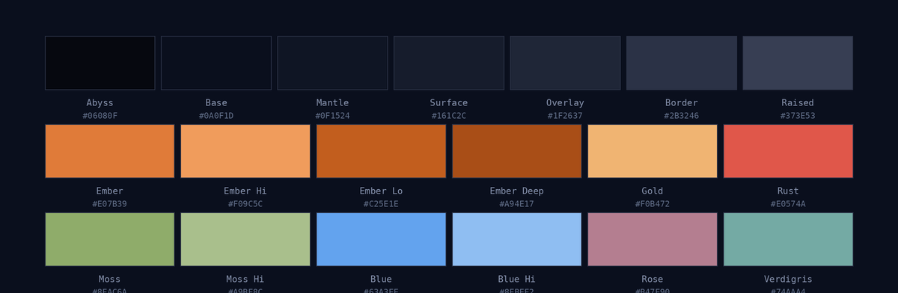

# Ambrite

> A cosy, ember-lit color scheme.

Sixteen opaque colors on a single blue-black base. Warm amber for attention,
muted moss for success, cold blue for structure — nothing pure white, nothing
pure black. Named for *ambrite*, the mineralogical term for fossil resin.



## Surfaces

| Token | Hex | Use |
| --- | --- | --- |
| `abyss` | `#06080F` | deepest shadow, behind everything |
| `base` | `#0A0F1D` | the background |
| `mantle` | `#0F1524` | panels that sit on the background |
| `surface` | `#161C2C` | cards, input fields |
| `overlay` | `#1F2637` | menus, popovers |
| `border` | `#2B3246` | separators, outlines |
| `raised` | `#373E53` | pressed states, scrollbars |

## Text

| Token | Hex | Use |
| --- | --- | --- |
| `text-bright` | `#DCE4F5` | headings, emphasis |
| `text` | `#B5C4DC` | body |
| `text-dim` | `#8793AE` | metadata, placeholders |
| `text-faint` | `#5F6C86` | disabled, comments |

## Accents

| Token | Hex | Use |
| --- | --- | --- |
| `ember` | `#E07B39` | primary accent, focus |
| `ember-hi` | `#F09C5C` | hover |
| `ember-lo` | `#C25E1E` | active, pressed |
| `ember-deep` | `#A94E17` | fills, emphasis |
| `gold` | `#F0B472` | warning, constants |
| `rust` | `#E0574A` | error, deletion |
| `moss` | `#8FAC6A` | success |
| `moss-hi` | `#A9BF8C` | success, hover |
| `blue` | `#63A3EE` | links, info |
| `blue-hi` | `#8FBEF2` | links, hover |
| `rose` | `#B47E90` | keywords, tags |
| `verdigris` | `#74AAA4` | types, interfaces |

## ANSI

```
0  #0A0F1D    8  #5F6C86
1  #E0574A    9  #EC7265
2  #8FAC6A   10  #A9BF8C
3  #F0B472   11  #F6C48E
4  #63A3EE   12  #8FBEF2
5  #B47E90   13  #CDA2B0
6  #74AAA4   14  #98C3BE
7  #B5C4DC   15  #DCE4F5
```

## Design rules

- **One hue for the dark.** Every surface sits at `hsl(222–227)`, saturation
  falling as lightness rises. Depth is darkness, never tint.
- **Ember means look here.** It is the only warm color allowed to be loud, and it
  is never spent on success or on danger.
- **Opaque only.** Values that need to recede move down the surface ramp — they do
  not become transparent.

## Ports

| Application | Status |
| --- | --- |
| Hyprland | shipped |
| Vesktop / Discord | shipped |
| kitty | planned |
| Neovim | planned |
| GTK / Qt | planned |

## License

MIT
